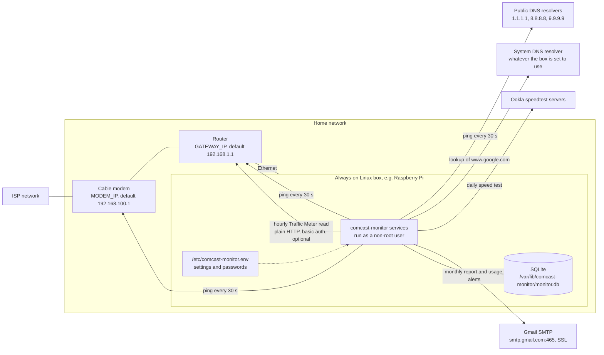
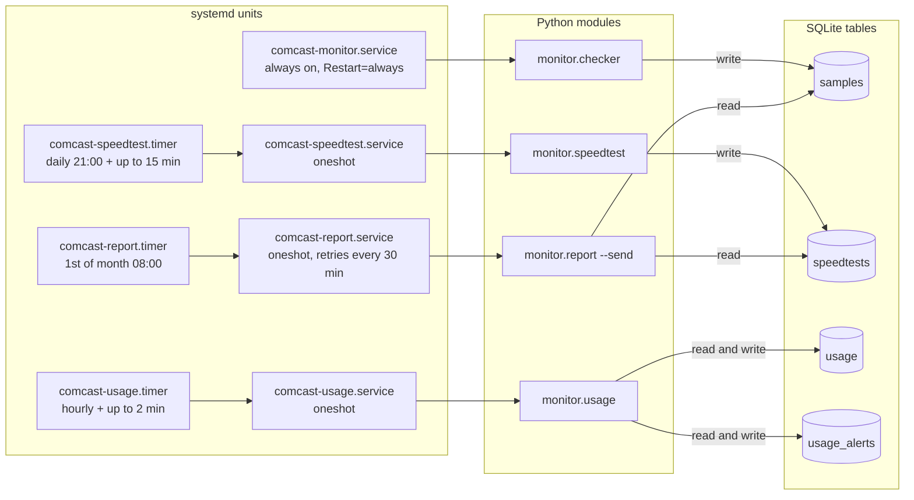
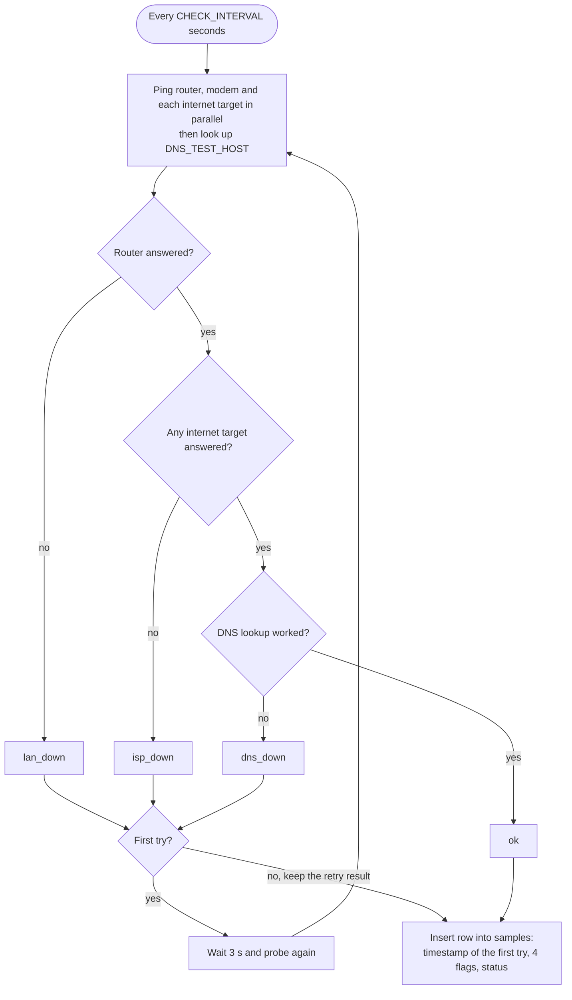
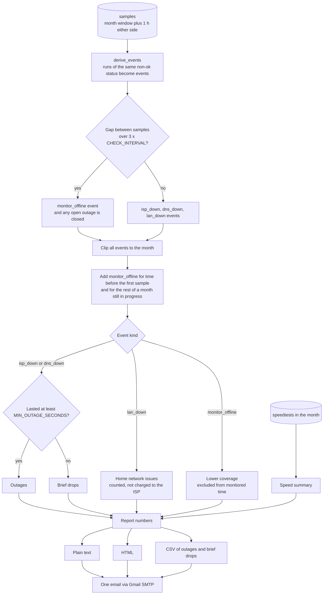

# Architecture

How the monitor is set up and how it turns pings into a monthly report. For installation see
[DEPLOY.md](DEPLOY.md); for settings see `config.example.env`.

The whole system is four small Python modules (standard library only), one SQLite file and a few systemd
units. Settings come from environment variables, loaded by systemd from `/etc/comcast-monitor.env`
(`monitor/config.py`).

## Deployment and network

The monitor runs on an always-on Linux box, such as a Raspberry Pi, plugged into the router with Ethernet.
A wired connection matters: on Wi-Fi, a Wi-Fi problem would look the same as an outage.

Notes:

- The modem ping usually travels through the router, since the modem's address is not on the LAN subnet.
- The DNS check calls `socket.getaddrinfo("www.google.com", 443)`, so it uses the box's normal resolver
  (often the router), not the three public servers directly.
- The Traffic Meter read only happens when `ROUTER_PASSWORD` is set. Without it the hourly job exits.
- Everything recorded stays in the SQLite file on the box. Only the emails carry data out.

## Components

`deploy/install.sh` copies the units to `/etc/systemd/system`, filling in the service user, then enables
and starts them. Every unit runs from `/opt/comcast-monitor`, loads `/etc/comcast-monitor.env` and has
`StateDirectory=comcast-monitor`, so systemd creates `/var/lib/comcast-monitor` owned by the service user.

| Unit | Schedule | Runs | Notes |
|---|---|---|---|
| `comcast-monitor.service` | Always on, starts after `network-online.target` | `python3 -m monitor.checker` | Restarts 10 s after any exit |
| `comcast-speedtest.timer` / `.service` | Daily at 21:00, random delay up to 15 min | `python3 -m monitor.speedtest` | Not `Persistent`, so a missed run is skipped |
| `comcast-usage.timer` / `.service` | Hourly, random delay up to 2 min, `Persistent` | `python3 -m monitor.usage` | Exits at once if `ROUTER_PASSWORD` is blank |
| `comcast-report.timer` / `.service` | 1st of each month at 08:00, `Persistent` | `python3 -m monitor.report --send` | On failure retries every 30 min, at most 12 starts per day |

`db.connect()` creates any missing tables on every start and turns on WAL mode, so the checker can keep
writing while a timer job reads. The `cm` helper (`/usr/local/bin/cm`) runs the same modules by hand with
the same settings, switching to the service user when started as root.

## Classification

Every `CHECK_INTERVAL` seconds (default 30) the checker takes one sample and stores it in `samples`. It pings
the router, the modem and each of `INTERNET_TARGETS` in parallel (`ping -c 1 -W 2`), then does one DNS
lookup of `DNS_TEST_HOST`. The checks are applied in order:

Details:

- Only one target out of `INTERNET_TARGETS` has to answer for the internet to count as up.
- The modem result never changes the status. It is stored as `modem_ok` and shows up in the report as
  "modem unreachable" on an outage.
- A non-`ok` result is retried exactly once. Whatever the retry says is stored, even if it differs from the
  first try. The row keeps the timestamp from the start of the first try.
- The checker logs to the journal only when the status changes.

## Monthly report

`monitor/report.py` builds the report for one month (by default the previous one) from the stored samples
and speed tests.

How the numbers are computed:

- **Events.** Consecutive non-`ok` samples with the same status form one event. It ends at the first sample
  with a different status. A gap of more than `3 x CHECK_INTERVAL` between samples becomes a
  `monitor_offline` event, from one interval after the last sample to the next sample. An outage open at a
  gap is closed there with the note "monitor went offline during this outage".
- **Outages vs brief drops.** Only `isp_down` and `dns_down` count against the ISP. Events of at least
  `MIN_OUTAGE_SECONDS` (default 120) are outages; shorter ones are brief drops.
- **Coverage** is the share of the month not covered by `monitor_offline`.
- **Uptime** is `1 - (outages + brief drops) / monitored time`.
- **Days affected** counts calendar days touched by an outage (brief drops do not count). If
  `MONTHLY_CHARGE` (or a `PROMO_CHARGE` for that month) is set, the credit estimate is days affected times
  the month's daily rate.
- **Speed** gives the count of passed and failed tests, median and minimum download and upload, and how many
  tests were under half of `PLAN_MBPS`.

The text part also has a ready-to-paste credit request when there were outages. The email is sent with the
text as the body, the HTML as an alternative part and `outages-YYYY-MM.csv` attached. Without `--send` the
report is only printed (and written to a file with `--out`).

## SQLite schema

The database is `/var/lib/comcast-monitor/monitor.db` (`DB_PATH`). Each table has an index on `ts`, except
`usage_alerts`, which is keyed by `key`. Timestamps are Unix seconds.

| Table | Written by | Read by | Columns |
|---|---|---|---|
| `samples` | checker, every 30 s | report | `ts`, `gateway_ok`, `modem_ok`, `internet_ok`, `dns_ok` (0 or 1), `status` (`ok`, `isp_down`, `dns_down`, `lan_down`) |
| `speedtests` | speedtest, daily | report | `ts`, `ok`, `download_mbps`, `upload_mbps`, `ping_ms`, `server`, `result_url`, `error` (failed tests store only `error`) |
| `usage` | usage, hourly | usage | `ts`, `month` (YYYY-MM), `today_mb`, `yesterday_mb`, `month_mb`, `month_up_mb`, `month_down_mb`, `last_month_mb` |
| `usage_alerts` | usage | usage | `key` (primary key, e.g. `cap90:2026-10`, `pace:2026-10`, `daily:2026-10-19`, `hourly:2026-10-20`, `steam:2026-10-20`), `ts` |

`usage` reads `usage` to find the highest reading of the last 24 hours as the baseline for the hourly spike
alert, and reads `usage_alerts` so that each alert is sent only once.

## What leaves the network

During normal running:

- **ICMP pings** to each address in `INTERNET_TARGETS` (default `1.1.1.1`, `8.8.8.8`, `9.9.9.9`), every
  `CHECK_INTERVAL` seconds, plus the modem ping if the modem sits outside the LAN.
- **One DNS lookup** of `DNS_TEST_HOST` (default `www.google.com`) per sample, through the box's resolver.
- **An Ookla speed test** once a day, run with `--accept-license --accept-gdpr`. It talks to Ookla's servers
  and uploads and downloads test data (roughly 1 GB at 800 Mbps).
- **Email through Gmail SMTP** (`SMTP_HOST:SMTP_PORT`, default `smtp.gmail.com:465` over SSL): the monthly
  report, and data-usage alerts when enabled. The report includes outage times, speed results and, if set,
  `CUSTOMER_NAME`, `SERVICE_ADDRESS`, `ACCOUNT_NUMBER`, `PLAN_NAME` and the price.

At install time only:

- `git clone` from GitHub, if you install that way.
- `install.sh` downloads the Ookla CLI from `install.speedtest.net` if `speedtest` is not already installed.

Traffic that stays on the LAN: the router ping, and the hourly Traffic Meter read from
`http://GATEWAY_IP/traffic_meter.htm` (followed by a sign-out at `/LGO_logout.htm`), and, if you use the
optional Steam helper, the PC's SSH copy of `steam.json` to the box every 5 minutes.

## Trust and security notes

- **Settings file.** `/etc/comcast-monitor.env` holds the Gmail app password and the router password.
  `install.sh` sets it to `root:<service group>`, mode `640`, and re-applies that on every run. Never commit
  the real file.
- **Router password over plain HTTP.** The Traffic Meter read uses HTTP basic auth over `http://`, so the
  router user and password cross the LAN unencrypted (basic auth is only base64). Use a router password you
  use nowhere else and keep the router's remote management off. Leave `ROUTER_PASSWORD` blank to turn the
  feature off. The job skips a reading rather than sign out someone already using the router page.
- **Gmail app password.** Use an app password, not the account password. It can be revoked on its own.
- **Dedicated non-root user.** By default `install.sh` creates a system user `comcast-monitor` with no login
  shell (`/usr/sbin/nologin`) and its home set to the state directory. All units run as that user. You can
  pick an existing user with `SERVICE_USER=...`; the scripts never run the services as root, but nothing
  stops you from naming `root`, so don't.
- **No extra sandboxing.** The units do not use systemd hardening options such as `ProtectSystem` or
  `NoNewPrivileges`. Pings rely on the distribution allowing unprivileged ICMP (Raspberry Pi OS and Debian
  do); the code needs no capabilities.
- **Input from the network.** The only data parsed from the network is the router's Traffic Meter page
  (regular expressions over the HTML) and the speedtest CLI's JSON output. Neither is executed. SQL uses
  parameter placeholders throughout.
- **Install script.** `install.sh` runs as root and pipes the Ookla download straight into `tar` over HTTPS,
  with no checksum check. Install the CLI yourself first if you want to verify it.
